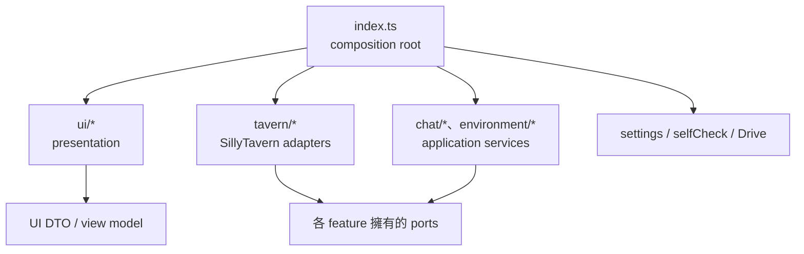

# UI 與酒館適配層責任拆分規劃

日期：2026-09-12  
狀態：已實作（2026-09-13）  
範圍：架構改善第 4 項，拆分 `src/ui.ts` 與 `src/tavern.ts`，並縮小各服務依賴的介面。

## 1. 目標

目前 `src/ui.ts` 約 2,227 行，混合面板狀態、操作流程、DOM 生命週期、HTML、CSS、自檢報告與設定持久化；`src/tavern.ts` 約 735 行，混合宿主探測、事件、通知、聊天讀寫、環境資料轉換與雲端拉取所需操作。兩者已成為功能修改時的共同衝突點，也讓服務依賴超過自身所需的能力。

完成後要達到：

1. `index.ts` 是唯一組裝 UI、應用服務與 SillyTavern 實作的地方。
2. UI 只負責呈現與使用者互動；不直接載入設定、不執行自檢、不認識 Drive 或 Tavern 實作。
3. 每個應用服務只依賴自己定義的窄介面，例如聊天同步不再依賴角色卡、Persona 或 Preset 能力。
4. Tavern 實作依功能拆分，所有 `globalThis`、parent window、原生 `/api/*` 與 Tavern Helper API 存取集中在平台層。
5. 保留現有 public import 與產品行為，逐階段搬移；每一階段都能獨立通過 `npm run verify`。

本工作是結構重構。同步規則、Drive 目錄、備份格式、畫面文案與視覺樣式原則上維持不變；只有為了建立明確邊界而必要的 callback／型別調整納入本次。

## 2. 目標依賴方向



強制規則：

- `ui/*` 不得 import `settings.ts`、`selfCheck.ts`、Drive client、ChatSyncService、Environment service 或 `tavern/*`。
- `chat/*` 與 `environment/*` 不得 import 具體 Tavern 實作。
- `tavern/*` 可 import feature port 與共用資料型別，不得 import UI。
- `index.ts` 負責把 `loadSettings`、`saveSettings`、`runSelfChecks` 與各服務操作包成 UI actions。
- 共用型別若只服務一個 feature，留在該 feature；不要把所有介面再次堆進 `types.ts`。

## 3. UI 拆分設計

### 3.1 目標檔案

```text
src/
├─ ui.ts                         # 暫時相容 façade，最終只 re-export
└─ ui/
   ├─ types.ts                   # PanelOptions、PanelController、screen/progress DTO
   ├─ panelController.ts         # 面板狀態與操作協調
   ├─ panelState.ts              # 純狀態與 reducer/transition
   ├─ panelHost.ts               # mount/unmount、focus、viewport、宿主 DOM
   ├─ events.ts                  # data-action / data-navigate 事件委派
   ├─ formatters.ts              # pill、pending、進度摘要、時間標籤
   ├─ views/
   │  ├─ shell.ts                # 面板骨架與 screen 容器
   │  ├─ home.ts
   │  ├─ chat.ts                 # upload/download/cloud browse
   │  ├─ environment.ts
   │  ├─ progress.ts
   │  ├─ settings.ts
   │  └─ selfCheck.ts
   ├─ selfCheckReport.ts         # 純摘要、遮罩與文字報告
   ├─ styles.ts                  # CSS 字串與一次性注入
   └─ html.ts                    # escapeHtml / escapeAttribute
```

不為每個十幾行函式建立檔案。若兩個 view 總量很小，可在實作時合併；目標是按「一起變更的原因」分組，而非追求檔案數量。

### 3.2 UI 邊界

新增 `PanelActions`，由 `index.ts` 實作。UI 收到結構化結果，不以丟出例外代表可預期的 queued／partial 狀態。

```ts
type PanelActions = {
  loadInitialState(): PanelInitialState;
  saveSettings(settings: Settings): Settings;
  connectDrive(): Promise<DriveConnectionState>;
  previewUpload(): Promise<UploadPreview>;
  uploadChat(): Promise<ChatOperationViewResult>;
  downloadChat(): Promise<ChatOperationViewResult>;
  backupEnvironment(input: BackupRequest, report: ProgressSink): Promise<BatchViewResult>;
  restoreEnvironment(input: RestoreRequest, report: ProgressSink): Promise<BatchViewResult>;
  listCloudRoles(): Promise<CloudRoleEntry[]>;
  listCloudChats(roleKey: string): Promise<CloudChatEntry[]>;
  pullChat(roleKey: string, chatId: string): Promise<ChatOperationViewResult>;
  runSelfChecks(mode: SelfCheckMode, report: SelfCheckProgressSink): Promise<SelfCheckResult[]>;
  copyText(text: string): Promise<void>;
  close(): void;
};
```

`ChatOperationViewResult` 至少區分 `done`、`queued`、`partial`、`aborted`，並帶使用者文案與可重試資訊。這能修正目前 UI 以「Promise resolve 即成功」推斷結果的隱性耦合，且不要求 UI 理解 Drive cleanup 或同步 receipt。

UI state 採純資料：目前 screen、context、drive state、progress rows、restore preview、cloud selection、自檢進度與 dialog 狀態。`panelState.ts` 提供純 transition；`panelController.ts` 呼叫 actions 並送 transition；view 只根據 state 產生 HTML 或局部更新資料。

### 3.3 DOM 與樣式責任

- `panelHost.ts` 擁有 host document、掛載點、floating layout、focus restore、Escape/focus trap、viewport listener 與 cleanup。
- `events.ts` 只把 DOM 事件轉成 controller command，所有 listener 必須回傳 disposer。
- `styles.ts` 保存目前約 700 行 CSS，透過固定 style id 保證只注入一次。
- views 不讀全域 DOM；需要 escape 的動態字串一律走 `html.ts`。
- controller 不直接拼 HTML。局部 render 由 view 函式完成，再由 host 套用。

### 3.4 UI 相容策略

先保留 `src/ui.ts`，由它 re-export 現有公開函式：`createPanel`、`renderPanel`、formatters、自檢報告與 cloud renderers。現有 `index.ts` 和測試可在搬移期間保持 import 不變。最後再將產品端 import 改到明確模組；`ui.ts` 留作測試／外部相容入口，控制在約 50 行內。

不在同一提交同時改 controller、HTML 結構與 CSS。搬移階段先保持既有 `data-*`、id、aria、文字及 class，避免結構重構被視覺差異掩蓋。

## 4. Tavern 適配層拆分設計

### 4.1 由 feature 擁有窄介面

目前 `TavernChatAdapter` 同時包含聊天 metadata、原始聊天、訊息 package、五種環境匯出與套用能力。改為：

```text
src/chat/ports/
├─ ChatSyncPort.ts               # ref、meta、raw export/save、package fallback
└─ ChatPullPort.ts               # 選角、聊天清單、建立並開啟聊天、meta

src/environment/
└─ EnvironmentPort.ts            # export/apply snapshot；按需要再分 read/write

src/app/
└─ TavernShellPort.ts            # context、事件、通知
```

- `ChatSyncService` 只接收 `ChatSyncPort`。
- `EnvironmentBackupService` 接收 `EnvironmentExportPort`。
- `EnvironmentRestoreService` 接收 `EnvironmentExportPort & EnvironmentApplyPort`。
- `ChatPullService` 保留自己擁有的 `ChatPullPort`，不依賴完整聊天 adapter。
- 自檢使用對應 port 或 capability probe，不因檢查一項能力而建立全能 adapter。

介面由使用者（application service）一側定義；Tavern 平台層負責實作。這能讓測試 fake 只提供案例實際使用的方法。

### 4.2 目標檔案

```text
src/
├─ tavern.ts                     # 暫時相容 façade，最終只組裝／re-export
└─ tavern/
   ├─ host.ts                    # globals、SillyTavern context、parent window
   ├─ capabilities.ts            # API 存在性探測與可診斷結果
   ├─ request.ts                 # request headers、/api/chats fetch wrapper
   ├─ shell.ts                   # getContext、events、notify
   ├─ chatRef.ts                 # 目前角色 avatar / native chat identity
   ├─ chatMeta.ts                # chat variables 與 sync metadata
   ├─ rawChat.ts                 # raw export/save、JSONL parse/count
   ├─ chatMessages.ts            # package fallback、swipe/role 轉換
   ├─ chatPull.ts                # 選角、聊天列表、建立並開啟聊天
   ├─ environment/
   │  ├─ character.ts
   │  ├─ world.ts
   │  ├─ persona.ts
   │  ├─ preset.ts
   │  └─ regex.ts
   └─ factory.ts                 # 建立 shell 與各 concrete adapter
```

`host.ts` 回傳包裝後的 runtime access，不把 `Record<string, any>` 傳遍所有檔案。初期可以保留小型 typed facade，例如 `TavernGlobals`，只列已使用能力；未知 API 回應仍為 `unknown`，在模組邊界驗證後才轉為 domain snapshot。

### 4.3 原生 API 與格式轉換

- `request.ts` 統一 `/api/chats/export`、`/api/chats/save`、`/api/characters/chats` 的 headers、錯誤格式與 cache 選項。
- `rawChat.ts` 接受明確 `TavernChatRef`，不得重新解析 current chat 取代傳入目標。
- `chatMessages.ts` 保留 legacy JSON package 相容；swipe、role 與 undefined 欄位處理集中在純函式，與宿主呼叫分開測試。
- 五種環境 adapter 各自驗證 API 能力並產生明確錯誤；Preset 的 raw OpenAI、Tavern Helper 與 legacy 路徑留在同一 preset 模組。
- `capabilities.ts` 提供結構化 capability，不把錯誤字串解析當成能力判定。

### 4.4 工廠與相容 façade

`factory.ts` 建議提供：

```ts
type TavernServices = {
  shell: TavernShellPort;
  chatSync: ChatSyncPort;
  chatPull: ChatPullPort;
  environment: EnvironmentExportPort & EnvironmentApplyPort;
  capabilities: TavernCapabilities;
};

function createTavernServices(): TavernServices;
```

搬移期間，`createTavernApi()` 與 `createTavernPullAdapter()` 仍由 `src/tavern.ts` 匯出，內部委派給新 factory。`index.ts` 最後改用 `createTavernServices()` 一次組裝，避免多次 factory 各自捕捉不同 runtime state。`selfCheck.ts` 也改為由入口注入 services／capabilities，避免反覆 `createTavernApi()`。

## 5. 實作階段

| 階段 | 修改內容 | 完成條件 |
|---|---|---|
| 0：鎖定行為 | 補 controller DOM、event unsubscribe、Tavern shell/event、raw chat 與各環境 adapter 的現況測試 | 重構前基線全過；記錄既有 HTML selectors 與 API request contract |
| 1：拆 service ports | 建立 ChatSync、Environment export/apply、Shell ports；修改 service constructor 與測試 fake | 每個 fake 不再實作無關方法；正式行為不變 |
| 2：抽 Tavern 純函式與 host | 搬 JSONL、message/swipe、role、preset validation、host/context/request helpers | 純函式各自測試；`tavern.ts` 不再保存轉換細節 |
| 3：拆 concrete adapters | 建立 shell、chat sync、chat pull、五類 environment 模組與 factory | `index.ts` 可由 `createTavernServices()` 完成組裝；舊 factory 相容測試仍過 |
| 4：抽 UI 純模組 | 搬 formatters、HTML escape、self-check report、views、CSS | `ui.ts` 明顯縮小；render 輸出與 aria/data contract 不變 |
| 5：拆 UI state/controller/host | 導入 PanelActions、純 state transition、host 與 events disposer | UI 不直接 import settings/selfCheck/domain services；mount/unmount 無 listener 泄漏 |
| 6：入口與相容層收尾 | `index.ts` 成為 composition root；調整 selfCheck 注入；縮小 façade、更新文件 | `ui.ts`／`tavern.ts` 僅保留薄 façade；完整 verify 與真實面板 smoke 通過 |

建議提交順序與上表一致。第 1～3 階段處理 Tavern 邊界，第 4～5 階段處理 UI；不要平行搬動 `index.ts` 的兩邊，以免同一提交同時失去組裝與呈現基準。

## 6. 測試規劃

### 6.1 架構與型別

- 各 service fake 只實作對應 port，TypeScript 編譯本身驗證介面已縮小。
- 加入輕量 architecture test，掃描 import：禁止 `ui/` 指向 settings、自檢、Drive、Tavern 與 application services；禁止 feature 指向 `tavern/` concrete modules。
- 檢查 `ui.ts` 與 `tavern.ts` façade沒有業務邏輯；避免未來再次膨脹。

### 6.2 UI

- `panelState`：screen navigation、開始／完成／部分失敗／queued、retry、連線 guard、自檢進度。
- views：動態值 escaping、cloud role/chat、restore preview、進度摘要、設定值與 aria/data contract。
- self-check report：敏感欄位遮罩、分類順序、空結果與失敗結果。
- controller DOM：click/keyboard routing、Escape、focus restore、重複 mount、unmount、resize listener cleanup、過時 async 結果。
- controller DOM 測試建議只為相關檔案啟用 `happy-dom` Vitest environment；它是 dev dependency，不進 production bundle。若不新增 dependency，至少以可注入 `PanelHost` fake 驗證 listener/disposer contract。
- CSS 搬移後比對 style id、關鍵 selector 與 production bundle；視覺驗收使用目前三種 viewport，不以整份 HTML snapshot 取代語意斷言。

### 6.3 Tavern adapters

- shell：context fallback、CHAT_CHANGED／GENERATION_ENDED fallback、unsubscribe、notify fallback。
- raw chat：明確 ref 的 export/save request body、切換聊天不 reload、錯誤 response、JSONL count/parse。
- message fallback：swipes、swipes_data、swipes_info、active swipe、role、hidden 與 optional fields。
- chat pull：選角、聊天列表、指定 avatar 保存、open 後目標核對。
- environment：五種 export/apply 各自的 API 缺失、成功與格式錯誤；Preset 三條相容路徑獨立覆蓋。
- capabilities：每項檢查只讀取必要 API，不執行真正寫入。

### 6.4 回歸與真實環境

每階段執行 `npm run verify`，最後執行：

1. 本地 SillyTavern 掛載面板，走訪所有 screen、返回、關閉與重新開啟。
2. 手動上傳、自動同步、下載覆蓋、建立其他聊天與五種環境備份／還原。
3. 快速與進階自檢、複製報告、敏感資訊遮罩。
4. 桌面窄視窗、手機尺寸與一般桌面尺寸的 focus、捲動、sticky footer。
5. 重複載入腳本後確認只有一份 style、launcher 與事件訂閱。

涉及聊天覆蓋或環境還原的真實驗收只能使用專用測試角色與可捨棄資料。

## 7. 驗收標準

- `src/ui.ts` 與 `src/tavern.ts` 各自成為約 50 行以內的相容 façade；若因公開型別 re-export 稍多，可接受，但不得保留流程與宿主實作。
- `ui/*` 不直接呼叫 `loadSettings`、`saveSettings`、`runSelfChecks`、Tavern globals、fetch 或 Drive。
- `ChatSyncService`、`EnvironmentBackupService`、`EnvironmentRestoreService`、`ChatPullService` 各自只接受窄 port。
- 所有宿主 global 與 `/api/*` 呼叫位於 `tavern/*`。
- 現有 HTML selector、aria、文案、同步與備份行為無非預期變更。
- 既有測試及新增的架構、state、controller、adapter 測試全部通過，production bundle 成功。
- 真實面板 smoke test 無重複 listener/style、無 console error，聊天切換安全測試仍通過。

## 8. 風險與控制

| 風險 | 控制方式 |
|---|---|
| 大量搬檔造成難以審查 | 每階段只搬一個責任，先 re-export，再改 consumer，最後刪舊實作 |
| HTML/CSS 搬移產生視覺差異 | 保持 selector 與字串不變；controller 和 CSS 不在同一提交重寫 |
| interface 拆分導致重複型別 | port 由使用它的 feature 擁有；共用 snapshot 才留 environment types |
| factory 重複建立造成事件／狀態分裂 | `index.ts` 只呼叫一次 `createTavernServices()`；舊 factory 委派同一組裝邏輯 |
| selfCheck 再次越過邊界 | 由入口注入 capabilities/ports；UI 只呼叫 `PanelActions.runSelfChecks` |
| 舊 JSON package 邊搬邊壞 | raw JSONL 與 legacy message fallback 分模組、分測試，保留相容 façade至最後 |
| 工作區已有未提交修改 | 小步套用並逐檔核對 diff，不覆寫或回退既有變更 |

第一個實作提交建議只做「階段 0＋階段 1」：先補邊界測試，再拆 service ports。這一批不搬 DOM 或 CSS，能先消除 `TavernChatAdapter` 的過寬依賴，並為後續搬檔建立穩定接口。
