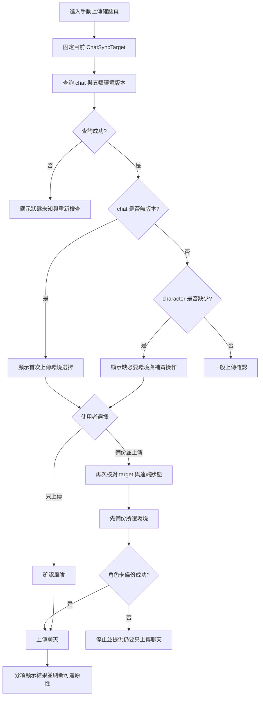

# 首次上傳聊天時提示環境備份開發計畫

日期：2026-10-19  
狀態：已實作，待真實酒館驗收  
範圍：手動首次上傳聊天的遠端可還原性檢查、環境備份提示、複合操作結果與驗收

## 1. 背景與問題

目前聊天與環境資料都存放在同一個聊天目錄下：

```text
SillyTavernSync/{role_key}/{chat_id}/
├─ chat/
├─ character/
├─ world/
├─ persona/
├─ preset/
└─ regex/
```

聊天上傳只會建立 `chat/*.jsonl`。若來源裝置沒有另外執行環境備份，其他裝置在本地找不到角色卡時，`ChatPullService` 也無法從該聊天的 `character/` 還原角色，因此會出現「聊天已在雲端，但無法在新裝置建立」的半完成狀態。

本功能在聊天第一次上傳前檢查遠端可還原性，讓使用者選擇同時備份必要或相關環境。提示必須是明確選擇，不能因為使用者上傳聊天就默認上傳 Persona、Preset 或 Regex 等可能包含個人設定與敏感內容的資料。

## 2. 目標

完成後應達到：

1. 手動上傳確認頁能辨識該 `role_key/chat_id` 是否尚無聊天版本。
2. 第一次上傳且缺少角色卡備份時，明確詢問是否一起備份環境。
3. 角色卡標示為「跨裝置建立聊天所需」；世界書標示為建議；Persona、Preset、Regex 保持選填。
4. 使用者可以選擇「備份環境並上傳」或「只上傳聊天」，不以隱含勾選取得敏感資料上傳同意。
5. 複合操作分別呈現環境備份與聊天上傳結果，不把部分成功顯示成全部完成。
6. 操作期間切換角色或聊天時中止尚未開始的本地匯出，不能把新聊天的環境上傳到舊聊天路徑。
7. 舊有「已有聊天版本、但缺角色卡備份」的資料能在確認頁看到修復提示並補齊環境。

## 3. 非目標

本輪不包含：

- 自動還原 Persona、Preset、Regex 或世界書；雲端拉取仍沿用既有角色卡還原流程。
- 改變現有 Drive 目錄結構，或把角色卡提升為角色層級共用備份。
- 自動同步事件彈出互動視窗。背景自動同步不可打斷聊天操作。
- 跨分頁或跨裝置的原子鎖。
- 一次性遷移或批次補齊所有既有雲端聊天。

## 4. 現況分析與共用原則

### 4.1 現有程式邏輯可直接共用的部分

目前不需要為「首次上傳一起備份環境」重寫 Drive 或 Tavern 操作：

| 現有能力 | 位置 | 可共用方式 |
|---|---|---|
| 固定聊天目標、JSONL 快照、待傳佇列、Drive 上傳、metadata 與 retention | `src/chat/ChatSyncService.ts` | 複合工作流呼叫 `uploadChat(target, options)`，不得複製另一套聊天上傳邏輯 |
| 指定項目的環境匯出、驗證、上傳、逐項結果與進度事件 | `src/environment/EnvironmentBackupService.ts` | 呼叫 `backupItems(kinds, { meta, onProgress })`，不得另寫首次上傳專用 export/upload 分支 |
| 環境版本查詢 | `EnvironmentBackupService.listItemVersions()`、`DriveService.listVersions()` | readiness service 共用相同路徑函式，平行查詢各項版本 |
| 環境路徑規則 | `environmentItemPath(meta, kind)` | 必須成為唯一環境路徑來源，避免 UI 或 workflow 自行拼接路徑 |
| 聊天路徑規則 | `driveChatPath(meta)` | readiness 與正式上傳使用同一函式 |
| 環境進度事件 | `EnvironmentProgressEvent` | 首次上傳與既有「備份酒館環境」使用同一事件語意 |

新的 `ChatUploadWorkflow` 只負責排程、政策與組合結果，不重新實作底層匯出、上傳、重試或清理。這是本功能最重要的程式共用邊界。

### 4.2 現有 UI 可沿用的視覺與互動元件

目前面板已經有一致的畫面骨架與操作元件：

- `src/ui/views/panel.ts` 的 `stepHeading()`、`stepFooter()`、`chatSummary()`、`iconButton()`。
- `environmentChoices()` 使用的 `.tr-choice-list`／`.tr-choice-row` 選項列。
- `renderUploadPreviewHtml()` 使用的 `.tr-summary-card` 與 `.tr-callout`。
- `src/ui/panelController.ts` 的 `beginProgress()`、`patchRow()`、環境進度事件轉換與逐項重試。
- `src/ui/styles.ts` 集中的主題 token、成功／警告／錯誤色、響應式 footer、44px 行動裝置按鈕與 `prefers-reduced-motion` 規則。

首次上傳功能不得另建一套卡片、checkbox、進度列或狀態顏色。確認頁繼續使用既有聊天摘要、summary card、choice row、callout 與 step footer；執行階段繼續使用同一個 progress screen。

### 4.3 現況不適合直接擴寫的部分

雖然視覺元件已存在，但目前多數是檔案內私有函式或硬編碼流程：

1. `environmentChoices()` 固定五項全部勾選，不能傳入「已有備份、必要、建議、敏感、預設選取」等狀態。
2. 環境項目名稱與說明分散在 `panel.ts`、`panelController.ts`，容易出現文案不一致。
3. `ProgressRow`、`ProgressOp`、`renderProgress()`、`ensureRows()` 與 `patchRow()` 都留在大型 `panelController.ts` 內，重試又以 `if/else` 綁死 operation 類型。
4. `runBackup()` 與 `runSingle('upload')` 是兩條分開流程，無法自然呈現「五個環境項目 + 一個聊天上傳」的同一份進度。
5. `collectSelectedItems()` 綁死 `data-input="backup-{kind}"`，首次上傳若照抄會產生第二套相似查詢函式。
6. `renderUploadPreviewHtml()` 只接受最新聊天檔名，無法呈現 readiness 與環境版本狀態。
7. `PanelOptions` 的 `onPreviewUpload()` 與 `onManualUpload()` 使用不同呼叫，沒有共享固定 preparation；這不只影響新功能，也可能造成預覽與確認操作不同聊天。

因此實作順序必須先抽共用模組，再組合新流程；禁止直接在 `panelController.ts` 追加一組首次上傳專用 checkbox、進度與重試程式。

### 4.4 共用模組調整方案

本輪使用專案內部共用模組，不新增 React、Vue、Tailwind 或其他 UI 相依套件。建議最小拆分如下：

```text
src/ui/
├─ environmentPresentation.ts   # 項目 label、description、必要性與敏感性呈現資料
├─ environmentSelection.ts      # 選項 view model、選取值收集與驗證
├─ progressModel.ts             # ProgressRow、狀態轉換、摘要與 retry descriptor
└─ views/
   ├─ shared.ts                 # stepHeading、stepFooter、chatSummary、iconButton
   ├─ environment.ts            # 共用環境選項列 renderer
   └─ progress.ts               # 共用進度 HTML renderer
```

檔名可依實作時的實際邊界微調，但必須滿足：

- 既有「備份酒館環境」、環境還原選擇與首次上傳使用同一個環境選項 renderer。
- renderer 接收 view model，不在 HTML 函式內查 Drive、讀設定或判斷產品政策。
- 共用環境項目 catalog 是 label、description 與 icon 的唯一來源。
- progress model 接受一般化 row key 與 retry descriptor；controller 不再依 `ProgressOp` 寫長串 `if/else`。
- 既有 class name 與 CSS token 優先保留，只在確實缺少狀態時補 modifier，例如 `.is-required`、`.is-available`。
- 共用模組抽取要先由既有畫面測試證明輸出與行為沒有退化，再讓新功能接入。

環境選項 renderer 建議介面：

```ts
type EnvironmentChoiceView = {
  kind: EnvironmentItemKind;
  label: string;
  description: string;
  selected: boolean;
  disabled: boolean;
  badge?: '必要' | '建議' | '已有備份' | '選填';
  latestFilename?: string | null;
};

renderEnvironmentChoices(input: {
  name: string;
  choices: EnvironmentChoiceView[];
}): string;
```

`name` 或等價 prefix 用來區分環境備份、環境還原與首次上傳三個表單，但收集選取值必須共用同一個 helper。

### 4.5 一致性與無障礙要求

新功能沿用目前面板的互動規則：

- 選項必須有可見 label 與 helper text，不能只靠 tooltip 或顏色說明必要性。
- 「必要／建議／已有備份」同時以文字 badge 表達，不能只改變顏色。
- readiness 查詢區使用既有 `aria-busy`、`role="status"`、`aria-live="polite"` 模式。
- 查詢完成後不移動使用者焦點；聊天切換使 preparation 失效時，將焦點放回確認頁標題或錯誤摘要。
- 主操作按鈕沿用 `.menu_button.menu_button_icon.tr-primary`，圖示繼續使用現有 Font Awesome，不新增 emoji 圖示。
- footer 沿用現有 640px／480px／360px 響應式規則；兩個主要選擇在窄畫面垂直排列且觸控高度至少 44px。
- 載入、部分成功、待補傳與失敗都使用既有 progress screen 與狀態色，並有文字狀態，不能只顯示 spinner 或顏色。
- 首次上傳以漸進揭露呈現：先顯示聊天摘要與必要說明，再讓使用者展開或選擇非必要環境，避免一次塞入過多技術細節。

## 5. 產品規則

### 5.1 第一次上傳的定義

以雲端實際狀態為準：

```text
firstUpload = chat/ 下沒有任何可辨識的 .jsonl 版本
```

不得只使用本地 `last_synced_version` 判斷，因為本地 metadata 可能遺失、來自另一裝置或尚未更新。

### 5.2 遠端可還原性分級

| 等級 | 條件 | 顯示與行為 |
|---|---|---|
| 可建立聊天 | `chat/` 有 JSONL，且 `character/` 有可用備份 | 正常顯示 |
| 缺必要環境 | 有聊天版本，但沒有角色卡備份 | 顯示警告與「補齊環境」操作 |
| 首次上傳 | 沒有聊天版本 | 顯示環境備份選擇；缺角色卡時強調跨裝置限制 |
| 狀態未知 | Drive 查詢失敗或結果不完整 | 不允許把狀態描述為安全；可重試檢查 |

角色卡是目前跨裝置建立聊天的必要備份。其他項目對還原後的對話品質或來源環境一致性有幫助，但不是 `ChatPullService` 建立聊天檔案的硬性前置條件。

### 5.3 使用者選擇

首次上傳確認頁提供兩個明確動作：

1. `備份所選環境並上傳`：先備份環境，再上傳聊天。
2. `只上傳聊天`：顯示確認警告後繼續；若缺角色卡，說明其他裝置可能無法建立此聊天。

建議的項目呈現：

| 項目 | 初始狀態 | 說明 |
|---|---|---|
| 角色卡 | 勾選、醒目標示必要 | 包含角色資料與頭像；供缺少角色卡的裝置建立聊天 |
| 世界書 | 勾選、標示建議 | 保存角色相關世界書與綁定，維持對話背景 |
| Persona | 不勾選 | 可能包含個人資料，需明確選擇 |
| Preset | 不勾選 | 屬於生成與提示詞設定，需明確選擇 |
| Regex | 不勾選 | 屬於全域規則，需明確選擇 |

若某項已有遠端版本，畫面顯示最新版本時間，初始狀態不重複勾選；使用者仍可主動選擇更新。

### 5.4 自動同步規則

自動同步不彈窗，避免在訊息完成事件中阻塞使用者。若自動同步先於手動確認建立第一份聊天版本：

- 聊天照常上傳。
- 面板顯示「聊天已備份，但缺少角色卡環境」的非阻塞警告。
- 使用者下次進入上傳確認頁時可執行「補齊環境」。

因此，互動提示的觸發條件是「手動上傳預檢」，遠端警告的判斷條件則是「缺少必要環境」，兩者不要混為同一個布林值。

## 6. 使用流程



## 7. 架構設計

### 7.1 新增聊天上傳預檢服務

新增 `src/chat/ChatUploadReadinessService.ts`，只負責讀取 Drive 狀態，不操作 UI：

```ts
type EnvironmentAvailability = {
  kind: EnvironmentItemKind;
  available: boolean;
  latestFilename: string | null;
};

type ChatUploadReadiness = {
  target: ChatSyncTarget;
  isFirstUpload: boolean;
  latestChatFilename: string | null;
  environment: EnvironmentAvailability[];
  recoveryStatus: 'ready' | 'missing_character' | 'first_upload';
};
```

`inspect(target)` 應平行查詢：

- `SillyTavernSync/{role_key}/{chat_id}/chat`
- `character`
- `world`
- `persona`
- `preset`
- `regex`

Drive 查詢錯誤必須向上回傳，不能把錯誤當成「沒有備份」。

### 7.2 新增複合工作流

新增 `src/chat/ChatUploadWorkflow.ts`，協調 `ChatSyncService`、`EnvironmentBackupService` 與 readiness service。UI 不直接串接兩個服務：

```ts
type ChatUploadRequest = {
  target: ChatSyncTarget;
  selectedEnvironment: EnvironmentItemKind[];
  allowChatOnlyAfterRequiredFailure: boolean;
};

type ChatUploadWorkflowResult = {
  status: 'done' | 'partial' | 'queued' | 'aborted';
  environmentResults: EnvironmentBackupResult[];
  chatResult: UploadResult | null;
  recoveryStatus: 'ready' | 'missing_character' | 'unknown';
};
```

工作流規則：

1. 確認時重新核對 `target.ref` 與 `contextRevision`。
2. 使用 `target.meta` 作為環境與聊天的共同 Drive 路徑來源。
3. 環境匯出前再次確認目前角色／聊天仍符合 target；既有環境 adapter 只能安全匯出目前環境，切換後必須中止。
4. 先執行所選環境備份，再執行聊天上傳。
5. 角色卡備份失敗時預設停止，回到使用者決策；不得自動降級成只上傳聊天。
6. 世界書、Persona、Preset 或 Regex 失敗時，聊天仍可上傳，但整體結果是 `partial`。
7. 環境成功、聊天失敗時保留已建立的環境版本；聊天沿用既有待傳佇列，不做回滾。

### 7.3 固定操作目標

目前 `onPreviewUpload()` 只回傳最新檔名，而 `onManualUpload()` 會重新擷取當下聊天。此功能加入後，預覽與確認必須共享同一個固定 target，否則可能預覽 A、切換到 B 後把 B 的環境備份到 A 的路徑。

建議 UI 只保存 opaque `preparationId`，實際 `ChatSyncTarget` 留在 composition root／workflow：

```ts
prepareChatUpload(): Promise<ChatUploadPreparationView>;
confirmChatUpload(input: {
  preparationId: string;
  selectedEnvironment: EnvironmentItemKind[];
  chatOnly: boolean;
}): Promise<ChatUploadWorkflowViewResult>;
```

聊天切換事件發生時，使既有 preparation 失效並清空確認頁選擇。確認過期 preparation 時回報「聊天已切換，請重新確認」，不得默默改用新聊天。

### 7.4 UI 結構化結果

調整 `src/ui/types.ts`，讓上傳流程回傳結構化結果，不再以字串或 throw 表達可預期的 `queued`／`partial` 狀態。

進度頁至少分成：

```text
環境備份
├─ 角色卡：完成／失敗／略過
├─ 世界書：完成／失敗／略過
├─ Persona：完成／失敗／略過
├─ Preset：完成／失敗／略過
└─ Regex：完成／失敗／略過

聊天上傳
└─ 完成／待補傳／失敗／未執行
```

整體摘要規則：

| 結果 | 摘要 |
|---|---|
| 必要環境及聊天成功 | 聊天與必要環境已備份，可供其他裝置建立 |
| 選填環境部分失敗、聊天成功 | 聊天已上傳，部分環境未完成 |
| 角色卡失敗、聊天未執行 | 必要環境備份失敗，尚未上傳聊天 |
| 使用者確認只上傳、聊天成功 | 聊天已上傳；其他裝置可能需要手動安裝角色卡 |
| 環境成功、聊天進入佇列 | 環境已備份，聊天等待補傳 |
| 操作期間切換聊天 | 操作已中止，未改用其他聊天 |

### 7.5 文案修正

一併修正現有「原雲端檔案先被備份，再覆蓋」文案。聊天上傳實際行為是新增版本，再按保留策略清理舊版；確認頁應改為：

> 這次上傳會新增一份聊天版本；超過保留數量時會清理最舊版本。

## 8. 實作階段

### 0. 共用 UI 與狀態模型

- [x] 抽出 environment presentation catalog，移除 view／controller 內重複 label 與 description。
- [x] 將 `environmentChoices()` 改成參數化的共用 renderer，先讓既有環境備份與還原接回同一元件。
- [x] 抽出 progress row 型別、render 與一般化 retry handler，保持既有進度畫面外觀。
- [x] 抽出或匯出共用的 step heading、footer、chat summary 與 icon button primitives。
- [x] 既有 DOM、keyboard、mobile responsive 與 panel tests 全部通過後，再接入首次上傳 UI。

### A. Readiness 查詢

- [x] 新增 `ChatUploadReadinessService` 與型別。
- [x] 以 Drive 實際版本判斷首次上傳與環境可用性。
- [x] 查詢失敗向上回傳，不與缺少備份混淆。
- [x] 新增無版本、完整環境、缺角色卡測試；重複資料夾沿用 DriveService 測試覆蓋。

### B. 固定預覽目標

- [x] `prepareChatUpload()` 建立固定 `ChatSyncTarget` 與 preparation ID。
- [x] 確認操作只接受有效 preparation。
- [x] 聊天切換時作廢舊 preparation。
- [x] 新增 preparation 過期與 target 切換時不得寫入的競態測試。

### C. UI 與同意流程

- [x] 使用共用聊天摘要、環境選項、callout 與 footer，首次上傳確認頁不另造平行元件。
- [x] 首次上傳確認頁加入環境清單、遠端狀態與用途說明。
- [x] 缺少的角色卡／世界書依規則預選；敏感環境預設不選。
- [x] 加入「備份所選環境並上傳」與「只上傳聊天」。
- [x] 只上傳聊天需二次確認跨裝置限制。
- [x] 已有聊天但缺角色卡時顯示補齊環境提示，不反覆顯示首次上傳文案。
- [x] 沿用既有主題 token、Font Awesome、focus-visible、aria-live 與 responsive footer 規則。

### D. 複合工作流

- [x] 新增 `ChatUploadWorkflow`。
- [x] workflow 僅組合 `EnvironmentBackupService.backupItems()` 與 `ChatSyncService.uploadChat()`，不複製底層邏輯。
- [x] 先環境、後聊天，並實作必要項與選填項失敗政策。
- [x] 保留既有聊天待傳與 retention 行為。
- [x] 將手動上傳改接 workflow；自動同步繼續直接使用 `ChatSyncService`。
- [x] UI 使用共用 progress model 顯示分項進度與結構化結果。

### E. 驗收與文件

- [x] 更新 `README.md`、`docs/api-notes.md` 與本開發計畫。
- [x] 執行 `npm run verify`（200 項測試通過；webpack 僅有既有 bundle size 警告）。
- [ ] 在專用測試角色、測試聊天與測試 Drive 目錄進行真實酒館驗收。

## 9. 測試矩陣

| 類別 | 案例 | 預期 |
|---|---|---|
| 首次判斷 | chat 無版本、環境皆無 | 顯示首次提示，角色卡必要說明可見 |
| 首次判斷 | chat 無版本、已有角色卡 | 顯示首次提示，但標示角色卡已有版本且不預選重傳 |
| 舊資料修復 | chat 有版本、character 無版本 | 顯示缺必要環境與補齊操作 |
| 完整狀態 | chat、character 皆有版本 | 不顯示阻斷警告 |
| 明確同意 | 選角色卡與世界書 | 只上傳所選項目後上傳聊天 |
| 敏感資料 | 未選 Persona／Preset／Regex | 不呼叫其 export 或 upload |
| 必要項失敗 | 角色卡匯出或上傳失敗 | 聊天不自動上傳，提供明確繼續選項 |
| 選填項失敗 | 世界書失敗、角色卡成功 | 聊天繼續上傳，結果為 partial |
| 聊天失敗 | 環境成功、聊天網路失敗 | 環境保留，聊天進既有佇列 |
| 使用者略過 | 確認只上傳聊天 | 上傳成功並顯示遠端可還原性警告 |
| 對象隔離 | 預覽 A 後切到 B | 確認失效；A、B 都不產生錯置環境 |
| 過時查詢 | A 查詢較晚回來，畫面已是 B | 丟棄 A 結果，不更新 B 的確認頁 |
| 自動同步 | 第一次由自動同步上傳 | 不彈窗；面板顯示缺環境警告 |
| 重複確認 | 雙擊確認按鈕 | 同一 preparation 只執行一次 |
| Drive 錯誤 | readiness 查詢 403／503 | 顯示狀態未知，不誤判為第一次或無環境 |
| 共用元件 | 既有環境備份、還原與首次上傳 | 三者由相同 renderer 產生環境選項，label 與描述一致 |
| 既有 UI 回歸 | 抽出 shared/progress 模組 | 現有畫面 DOM、進度、重試與 responsive class 不變 |
| 無障礙 | 鍵盤操作與螢幕閱讀器狀態 | 選項有可見 label；狀態有文字；焦點不遺失；查詢以 polite live region 回報 |
| 行動版 | 480px、360px 寬度 | footer 操作垂直排列、無水平捲動、按鈕至少 44px 高 |

## 10. 真實環境驗收

使用可捨棄角色與聊天，至少驗證：

1. 裝置 A 首次上傳，選擇角色卡與世界書。
2. 裝置 B 沒有角色卡，從雲端建立聊天，確認角色卡可自動還原並開啟聊天。
3. A 只上傳聊天，B 沒有角色卡時得到明確且可處理的錯誤。
4. 首次確認頁開啟後切換到另一聊天，確認舊操作無法送出。
5. 角色卡成功、世界書失敗及聊天失敗三種部分完成結果均顯示正確。
6. 大型角色頭像與較大世界書上傳時，進度與錯誤不會被聊天結果覆蓋。
7. 同一輪操作與既有「備份酒館環境」在選項列、進度列、成功／警告／錯誤狀態及行動版排列上保持一致。

## 11. 完成標準

- 第一次手動上傳可在同一流程備份必要環境。
- 未經使用者明確選擇，不上傳 Persona、Preset 或 Regex。
- 新裝置缺少本地角色卡時，可利用首次流程產生的角色卡備份建立雲端聊天。
- 預覽、環境備份與聊天上傳始終綁定同一個 immutable target。
- 所有部分成功、待補傳與中止情況都有正確結構化結果與 UI 文案。
- 首次上傳、既有環境備份與環境還原共用環境選項 renderer、presentation catalog 與 progress model，沒有複製的狀態映射或平行 CSS 元件。
- 新功能沿用既有主題、按鈕、卡片、callout、focus 與 responsive 規則；新增 CSS 僅限必要 modifier。
- 自動測試、型別檢查、lint 與 production build 全部通過。
- 真實 SillyTavern／Google Drive 驗收完成並記錄結果。

## 12. 後續可選改進

目前每個 `chat_id` 各自保存一份角色卡與環境，容易重複佔用空間。後續可另案評估：

- 角色層級共用 `character/` 與環境 manifest。
- 聊天只記錄其依賴的環境版本 ID。
- 雲端瀏覽頁直接顯示「可完整還原／缺角色卡／缺選填環境」。
- 拉取聊天時提供選擇性環境還原，而不只在缺少角色卡時處理角色資料。

這些調整會涉及既有 Drive 路徑相容與遷移，不納入本輪首次上傳提示。
